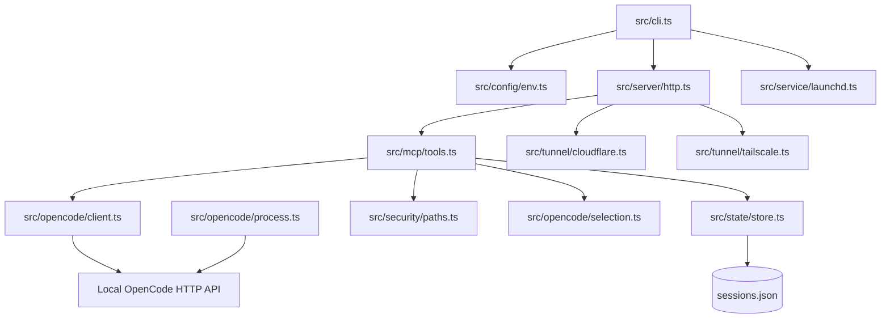

# OpenCode Most — Architecture

**Version:** 1.0.0-beta.1  
**Language:** TypeScript / Node.js (ES modules, NodeNext)  
**Build:** `tsc` to `dist/`  
**Tests:** Vitest (`tests/**/*.test.ts`)

OpenCode Most is a local MCP (Model Context Protocol) bridge that connects ChatGPT to a locally running OpenCode server. It exposes a Streamable HTTP MCP endpoint at `/mcp`, manages one persistent OpenCode session per repository, and optionally exposes the bridge through a Cloudflare or Tailscale tunnel.

This document describes only flows confirmed by the source code. It does not describe planned or speculative functionality.

## 1. Component boundaries

The codebase is organized into the following module layers:

| Layer | Files | Responsibility |
|----------|-------|------------------|
| CLI entry | `src/cli.ts` | Argument parsing, command dispatch (`init`, `start`, `doctor`, `install-service`, `uninstall-service`, `service-status`) |
| Configuration | `src/config/env.ts`, `src/config/bootstrap.ts` | Environment variables, `.env` handling, OpenCode `service.json` reading, `loadConfig()` |
| HTTP/MCP server | `src/server/http.ts` | Express app, Streamable HTTP MCP transport, `/health`, `/mcp` (POST/GET/DELETE), authentication middleware, automatic port selection |
| MCP tools | `src/mcp/tools.ts` | `createBridgeMcpServer()`, all registered MCP tools (sessions, messages, diff, capabilities, etc.) |
| MCP session lifecycle | `src/mcp/session-lifecycle.ts` | Safe deletion of idle sessions, locator-based deletion for unmapped sessions |
| MCP results | `src/mcp/results.ts` | `safeTool()` wrapper for consistent error handling in MCP tools |
| OpenCode client | `src/opencode/client.ts` | `OpencodeClient` — HTTP client for local OpenCode API (`/api/session`, `/api/event`, `/api/fs/*`, `/api/vcs/*`, etc.) |
| OpenCode process | `src/opencode/process.ts` | `OpencodeProcessManager` — spawns `opencode serve` per repository, health checks, port discovery |
| OpenCode CLI setup | `src/opencode/setup.ts` | `checkOpencodeCli()` — verifies `opencode` binary availability |
| Model/agent selection | `src/opencode/selection.ts` | `validateModelAgentSelection()` — validates provider/model/agent compatibility |
| OpenCode session CLI | `src/opencode/session-cli.ts` | CLI-based session listing/deletion for unmapped sessions |
| State store | `src/state/store.ts` | `StateStore` — persistent session mappings in `sessions.json` |
| Security/paths | `src/security/paths.ts` | `validateRepoPath()`, `listProjects()` — allowed-roots enforcement with `realpath` checks |
| Setup guide | `src/setupGuide.ts` | Human-readable setup instructions printed at startup |
| macOS service | `src/service/launchd.ts` | LaunchAgent plist generation, installation, uninstallation, status |
| Tunnel: Cloudflare | `src/tunnel/cloudflare.ts` | `cloudflared tunnel --url` — quick tunnel |
| Tunnel: Tailscale | `src/tunnel/tailscale.ts` | `tailscale funnel` and public URL resolution |

Entry point (compiled): `dist/cli.js`, invoked as the `opencode-most` binary (`bin` field in `package.json`).

## 2. Configuration

Configuration is resolved by `loadConfig()` in `src/config/env.ts` with the following precedence:
1. CLI arguments (`--key value` or `--key=value`)
2. Environment variables (`OPENCODE_BRIDGE_*`, `OPENCODE_SERVER_*`, `CLOUDFLARED_BIN`, `TAILSCALE_BIN`)
3. Hard-coded defaults

Key configuration fields (`BridgeConfig` in `src/types.ts`):

| Field | Default | Source |
|------|----------|--------|
| `host` | `127.0.0.1` | `--host`, `OPENCODE_BRIDGE_HOST` |
| `port` | `8787` | `--port`, `OPENCODE_BRIDGE_PORT` |
| `autoPort` | `true` | `--auto-port`, `OPENCODE_BRIDGE_AUTO_PORT` |
| `allowedHosts` | `["127.0.0.1", "localhost"]` | `--allowed-hosts`, `OPENCODE_BRIDGE_ALLOWED_HOSTS` |
| `allowedRoots` | `[process.cwd()]` | `--allowed-roots`, `OPENCODE_BRIDGE_ALLOWED_ROOTS` (colon-separated) |
| `bridgeToken` | undefined | `--token`, `OPENCODE_BRIDGE_TOKEN` |
| `tunnel` | `"none"` | `--tunnel`, `OPENCODE_BRIDGE_TUNNEL` (`none` \| `cloudflare` \| `tailscale`) |
| `opencodeBaseUrl` | undefined | `OPENCODE_BASE_URL`, or `url` field from OpenCode `service.json` |
| `opencodeBin` | `opencode` | `--opencode-bin`, `OPENCODE_BIN` |
| `opencodeHost` | `127.0.0.1` | `--opencode-host`, `OPENCODE_BRIDGE_OPENCODE_HOST` |
| `opencodePortStart` | `4096` | `--opencode-port-start`, `OPENCODE_BRIDGE_OPENCODE_PORT_START` |
| `opencodeUsername` | `opencode` | `--opencode-username`, `OPENCODE_SERVER_USERNAME` |
| `opencodePassword` | undefined | `OPENCODE_SERVER_PASSWORD`, or `password` field from OpenCode `service.json` |
| `stateDir` | `~/.opencode-chatgpt-bridge` | `--state-dir`, `OPENCODE_BRIDGE_STATE_DIR` |
| `cloudflaredBin` | `cloudflared` | `--cloudflared-bin`, `CLOUDFLARED_BIN` |
| `tailscaleBin` | `tailscale` | `--tailscale-bin`, `TAILSCALE_BIN` |

OpenCode credentials are read from `~/.local/state/opencode/service.json` (fields `url` and `password`). The legacy `~/.config/opencode/service.json` path is not used. If `OPENCODE_SERVER_AUTH_DISABLED=1`, credentials are not loaded.

**Authentication requirement:** `OPENCODE_BRIDGE_TOKEN` is required when `tunnel !== "none"` or when `host` is not a loopback address (`127.0.0.1`, `localhost`, `::1`).

## 3. Request/response flow

```
ChatGPT / MCP client
      |
      v
[HTTPS tunnel] or [direct HTTP on 127.0.0.1:port]
      |
      v
Express app (src/server/http.ts)
      |
      +-- GET /health  -> bridge status, managed processes, token preview
      +-- /mcp (POST/GET/DELETE)
            |
            v
      authMiddleware (bearer token or token in path/query)
            |
            v
      StreamableHTTPServerTransport (MCP SDK)
            |
            v
      createBridgeMcpServer (src/mcp/tools.ts)
            |
            v
      OpencodeClient (src/opencode/client.ts)
            |
            v
      HTTP to local opencode serve (127.0.0.1:<port>/api/*)
```

MCP sessions use the `mcp-session-id` header for transport continuity. On `initialize` without a session ID, a new `StreamableHTTPServerTransport` is created with UUID as session ID. On close, the transport is removed from the in-memory registry.

All MCP tools are wrapped by `safeTool()` (`src/mcp/results.ts`), which catches errors and returns a consistent JSON error structure instead of throwing.

## 4. Session lifecycle

The bridge maintains exactly one active OpenCode session per repository. Session state is persisted in `sessions.json` under the `stateDir` (default `~/.opencode-chatgpt-bridge/sessions.json`).

### Session creation (`opencode_create_session`)
1. Validate `repoPath` against `allowedRoots` (`validateRepoPath` with `realpath` resolution).
2. Ensure a running OpenCode process for this repository (`OpencodeProcessManager.ensure`): spawns `opencode serve --hostname 127.0.0.1 --port <auto>` if `OPENCODE_BASE_URL` is not set; generates a random password per managed server.
3. Create an OpenCode session via the client API (`/api/session` POST with `location.directory`).
4. Confirm that the session location matches the expected `repoPath`.
5. Create a bridge session mapping (`bridgeSessionId`, `opencodeSessionId`, `repoPath`, `baseUrl`) in `StateStore`.
6. Set the bridge session as active for this repository.

### Active session (`opencode_get_active_session` / `opencode_set_active_session`)
- One active bridge session per `repoPath` is tracked in `activeSessions` in `sessions.json`.
- `getActiveSession` performs legacy migration: if no explicit active mapping exists, adopts the most recently used session for this repository.

### Message flow (`opencode_send_message`)
1. Resolve the bridge session (by `bridgeSessionId` or active session for `repoPath`).
2. Ensure a healthy OpenCode process.
3. Optionally select model/agent before sending.
4. POST to `/api/session/{id}/prompt` with `delivery: "steer"`.
5. If `async === false`, wait for session idle via SSE event stream (`/api/event`), then fetch the latest assistant message.

### Waiting for completion (`opencode_wait_for_completion`)
- Listens to OpenCode's native SSE event stream (`/api/event`) until the session becomes idle or a terminal event arrives (`session.idle`, `session.execution.succeeded/failed/interrupted`).
- Default timeout: 180 seconds (maximum 600).
- Sends an MCP notification (`notifications/message`) upon completion.

### Session deletion
- `opencode_delete_session`: deletes an idle/completed session by `bridgeSessionId`. Refuses to delete running sessions. Removes the bridge mapping only after OpenCode confirms deletion (or returns 404, meaning the session no longer exists).
- `opencode_delete_session_by_locator`: deletes an unmapped OpenCode session by exact `sessionDirectory` and `title` (case-sensitive). Refuses ambiguous matches. Uses the official `opencode` CLI for deletion.

## 5. Communication with OpenCode

The bridge communicates with OpenCode exclusively over local HTTP:

- Managed mode: `opencode serve --hostname 127.0.0.1 --port <auto>` is spawned per repository. A random password (24 bytes hex) is generated per server and passed via `OPENCODE_SERVER_PASSWORD`.
- External mode: if `OPENCODE_BASE_URL` is set, the bridge uses that existing OpenCode server instead of spawning one.
- Authentication: Basic Auth header (`username:password`) on every request. Username defaults to `opencode`.
- The OpenCode server is bound only to `127.0.0.1`; it is never exposed externally. Only the bridge is exposed to ChatGPT.

## 6. Error handling

| Situation | Behavior |
|----------|------------|
| Missing/invalid bridge token (tunnel or non-loopback host) | `loadConfig()` throws before server starts |
| Missing/invalid bearer token on `/mcp` | HTTP 401 `{"error": "Missing or invalid bearer token"}` |
| Invalid MCP session ID | HTTP 400 JSON-RPC error `-32000` |
| Internal MCP tool error | HTTP 500 JSON-RPC error `-32603` with message |
| Port in use | Automatic selection of next free port (up to 50 attempts), or error if `autoPort=false` |
| OpenCode health check timeout | 20-second timeout, then error |
| Tunnel URL timeout | 20-second timeout, then error |
| Deletion of running session | Refused with descriptive error |
| Ambiguous locator match | Refused with descriptive error |

## 7. Security and authentication

- **Bridge token:** `OPENCODE_BRIDGE_TOKEN` is required when tunneling is enabled or when listening on a non-loopback host. Accepted via `Authorization: Bearer <token>` header, `?token=` query parameter, or `/mcp/<token>` path token.
- **Token masking:** `maskToken()` in `src/config/env.ts` shows only first and last 4 characters in HTTP responses (`/health`, setup guide). Tokens are never written to logs in plain form.
- **Repository allow-listing:** `validateRepoPath()` resolves both the requested path and allowed roots via `realpath`, then checks `isInside()` using `path.relative()`. Only repositories under allowed roots are accessible.
- **Localhost binding:** The OpenCode process is bound only to `127.0.0.1`. Bridge host defaults to `127.0.0.1`.
- **No arbitrary shell execution:** No shell execution tool is exposed by the bridge. All interaction with OpenCode goes through its HTTP API.

## 8. Build, test, and dependencies

### Build
- TypeScript compiler (`tsc`) with `tsconfig.json`: target `ES2022`, module `NodeNext`, strict mode, `outDir: dist`, `rootDir: src`.
- Command: `pnpm run build` (`tsc -p tsconfig.json`).
- Output: `dist/` (JavaScript + declaration maps + source maps).
- `dist` and `node_modules` are gitignored.

### Tests
- Vitest (`vitest.config.ts`): includes `tests/**/*.test.ts`, Node.js environment.
- Command: `pnpm test` (`vitest run`).
- 15 test files, 120 tests (state as of current code).

### Validation
- `pnpm run validate` runs `typecheck` + `test` + `build`.

### Runtime dependencies (`package.json`)
| Dependency | Purpose |
|-----------|---------------|
| `@modelcontextprotocol/sdk` | MCP server SDK (Express transport, Streamable HTTP) |
| `dotenv` | `.env` file loading |
| `express` | HTTP server for MCP and health endpoints |
| `zod` | Input schema validation for MCP tools |

### Dev dependencies
`@types/express`, `@types/node`, `tsx`, `typescript`, `vitest`.

### External tools (not installed by the bridge)
- `opencode` — must be installed and authenticated locally
- `cloudflared` — required only for Cloudflare tunnel
- `tailscale` — required only for Tailscale Funnel

## 9. Service modes

### macOS LaunchAgent
- `src/service/launchd.ts` generates a `com.yuga.opencode-chatgpt-bridge.plist`.
- Installed to `~/Library/LaunchAgents/`.
- Runs `node dist/cli.js start --tunnel none --port 8790 --auto-port false` with `WorkingDirectory` set to the repository directory.
- Logs to `~/.opencode-chatgpt-bridge/bridge.log` and `bridge.err.log`.
- Managed via `pnpm run install-service`, `uninstall-service`, `service-status`.

### Linux systemd --user
- Installer script: `scripts/systemd/install-user.sh`.
- Units: `opencode-most.service`, `opencode-most-tunnel.service`, `opencode-most.target`.
- Installed to `~/.config/systemd/user/`.
- Tunnel client expected at `$HOME/Projekty/OmniCommanderMCP/tunnel-client-v0.0.16-linux-amd64/tunnel-client` (overridable via `TUNNEL_DIR`, `TUNNEL_BIN`, `TUNNEL_KEY`).
- Tunnel credential supplied to systemd through `LoadCredential=`.

## 10. Diagram: module dependencies



## 11. Limitations and non-goals (confirmed by code)

- The bridge does not install or reconfigure OpenCode itself.
- Remaining provider-account quotas are not exposed; HTTP 429 responses and `Retry-After` headers are forwarded as-is.
- OpenCode v2 `session.prompt` does not support per-message `system` or `tools` overrides (enforced in `client.ts`).
- The legacy `~/.config/opencode/service.json` path is not used.
- Windows is not supported as a service platform.
- No arbitrary shell execution tool is exposed.