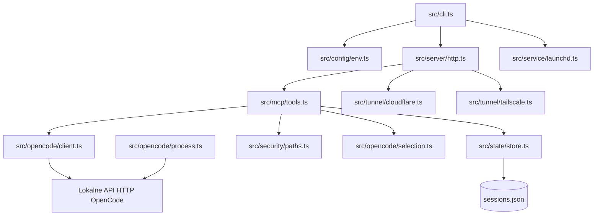

# OpenCode Most — Architektura

**Wersja:** 1.0.0-beta.1  
**Język:** TypeScript / Node.js (moduły ES, NodeNext)  
**Kompilacja:** `tsc` do `dist/`  
**Testy:** Vitest (`tests/**/*.test.ts`)

OpenCode Most to lokalny most MCP (Model Context Protocol) łączący ChatGPT z lokalnie uruchomionym serwerem OpenCode. Udostępnia endpoint MCP Streamable HTTP pod `/mcp`, zarządza jedną trwałą sesją OpenCode na repozytorium i opcjonalnie wystawia most przez tunel Cloudflare lub Tailscale.

Niniejszy dokument opisuje wyłącznie przepływy potwierdzone kodem źródłowym. Nie opisuje funkcji planowanych ani spekulatywnych.

## 1. Granice komponentów

Kod źródłowy jest zorganizowany w następujące warstwy modułów:

| Warstwa | Pliki | Odpowiedzialność |
|----------|-------|------------------|
| Wejście CLI | `src/cli.ts` | Parsowanie argumentów, rozdzielanie komend (`init`, `start`, `doctor`, `install-service`, `uninstall-service`, `service-status`) |
| Konfiguracja | `src/config/env.ts`, `src/config/bootstrap.ts` | Zmienne środowiskowe, obsługa `.env`, odczyt OpenCode `service.json`, `loadConfig()` |
| Serwer HTTP/MCP | `src/server/http.ts` | Aplikacja Express, transport Streamable HTTP MCP, `/health`, `/mcp` (POST/GET/DELETE), middleware uwierzytelniania, automatyczny wybór portu |
| Narzędzia MCP | `src/mcp/tools.ts` | `createBridgeMcpServer()`, wszystkie zarejestrowane narzędzia MCP (sesje, wiadomości, diff, możliwości itp.) |
| Cykl życia sesji MCP | `src/mcp/session-lifecycle.ts` | Bezpieczne usuwanie bezczynnych sesji, usuwanie na podstawie lokalizatora dla sesji nieobjętych mapowaniem |
| Wyniki MCP | `src/mcp/results.ts` | Otulacz `safeTool()` dla spójnej obsługi błędów w narzędziach MCP |
| Klient OpenCode | `src/opencode/client.ts` | `OpencodeClient` — klient HTTP dla lokalnego API OpenCode (`/api/session`, `/api/event`, `/api/fs/*`, `/api/vcs/*` itp.) |
| Proces OpenCode | `src/opencode/process.ts` | `OpencodeProcessManager` — uruchamia `opencode serve` na każde repozytorium, sprawdzanie kondycji, wykrywanie portu |
| Konfiguracja CLI OpenCode | `src/opencode/setup.ts` | `checkOpencodeCli()` — weryfikuje dostępność binarnego pliku `opencode` |
| Wybór modelu i agenta | `src/opencode/selection.ts` | `validateModelAgentSelection()` — waliduje kompatybilność dostawcy/modelu/agenta |
| Klient sesji OpenCode | `src/opencode/session-cli.ts` | Listowanie i usuwanie sesji przez CLI dla sesji nieobjętych mapowaniem |
| Magazyn stanu | `src/state/store.ts` | `StateStore` — trwałe mapowania sesji w `sessions.json` |
| Bezpieczeństwo/ścieżki | `src/security/paths.ts` | `validateRepoPath()`, `listProjects()` — egzekwowanie dozwolonych korzeni ze sprawdzaniem `realpath` |
| Przewodnik konfiguracji | `src/setupGuide.ts` | Czytelne instrukcje konfiguracji drukowane przy uruchomieniu |
| Usługa macOS | `src/service/launchd.ts` | Generowanie pliku LaunchAgent, instalacja, odinstalowanie, status |
| Tunel: Cloudflare | `src/tunnel/cloudflare.ts` | `cloudflared tunnel --url` — szybki tunel |
| Tunel: Tailscale | `src/tunnel/tailscale.ts` | `tailscale funnel` i rozpoznawanie publicznego URL |

Punkt wejścia (skompilowany): `dist/cli.js`, wywoływany jako binarny plik `opencode-most` (pole `bin` w `package.json`).

## 2. Konfiguracja

Konfiguracja jest rozpoznawana przez `loadConfig()` w `src/config/env.ts` w następującym priorytecie:
1. Argumenty CLI (`--key value` lub `--key=value`)
2. Zmienne środowiskowe (`OPENCODE_BRIDGE_*`, `OPENCODE_SERVER_*`, `CLOUDFLARED_BIN`, `TAILSCALE_BIN`)
3. Wartości domyślne w kodzie

Kluczowe pola konfiguracji (`BridgeConfig` w `src/types.ts`):

| Pole | Domyślne | Źródło |
|------|----------|--------|
| `host` | `127.0.0.1` | `--host`, `OPENCODE_BRIDGE_HOST` |
| `port` | `8787` | `--port`, `OPENCODE_BRIDGE_PORT` |
| `autoPort` | `true` | `--auto-port`, `OPENCODE_BRIDGE_AUTO_PORT` |
| `allowedHosts` | `["127.0.0.1", "localhost"]` | `--allowed-hosts`, `OPENCODE_BRIDGE_ALLOWED_HOSTS` |
| `allowedRoots` | `[process.cwd()]` | `--allowed-roots`, `OPENCODE_BRIDGE_ALLOWED_ROOTS` (rozdzielone dwukropkiem) |
| `bridgeToken` | undefined | `--token`, `OPENCODE_BRIDGE_TOKEN` |
| `tunnel` | `"none"` | `--tunnel`, `OPENCODE_BRIDGE_TUNNEL` (`none` \| `cloudflare` \| `tailscale`) |
| `opencodeBaseUrl` | undefined | `OPENCODE_BASE_URL`, lub pole `url` z OpenCode `service.json` |
| `opencodeBin` | `opencode` | `--opencode-bin`, `OPENCODE_BIN` |
| `opencodeHost` | `127.0.0.1` | `--opencode-host`, `OPENCODE_BRIDGE_OPENCODE_HOST` |
| `opencodePortStart` | `4096` | `--opencode-port-start`, `OPENCODE_BRIDGE_OPENCODE_PORT_START` |
| `opencodeUsername` | `opencode` | `--opencode-username`, `OPENCODE_SERVER_USERNAME` |
| `opencodePassword` | undefined | `OPENCODE_SERVER_PASSWORD`, lub pole `password` z OpenCode `service.json` |
| `stateDir` | `~/.opencode-chatgpt-bridge` | `--state-dir`, `OPENCODE_BRIDGE_STATE_DIR` |
| `cloudflaredBin` | `cloudflared` | `--cloudflared-bin`, `CLOUDFLARED_BIN` |
| `tailscaleBin` | `tailscale` | `--tailscale-bin`, `TAILSCALE_BIN` |

Poświadczenia OpenCode są odczytywane z `~/.local/state/opencode/service.json` (pola `url` i `password`). Ścieżka dziedziczna `~/.config/opencode/service.json` nie jest używana. Jeśli `OPENCODE_SERVER_AUTH_DISABLED=1`, poświadczenia nie są wczytywane.

**Wymóg uwierzytelniania:** `OPENCODE_BRIDGE_TOKEN` jest wymagany gdy `tunnel !== "none"` lub gdy `host` nie jest adresem loopback (`127.0.0.1`, `localhost`, `::1`).

## 3. Przepływ żądania/odpowiedzi

```
ChatGPT / klient MCP
      |
      v
[Tunel HTTPS] lub [bezpośrednie HTTP na 127.0.0.1:port]
      |
      v
Aplikacja Express (src/server/http.ts)
      |
      +-- GET /health  -> status mostu, zarządzane procesy, podgląd tokena
      +-- /mcp (POST/GET/DELETE)
            |
            v
      authMiddleware (token nośnika lub token w ścieżce/query)
            |
            v
      StreamableHTTPServerTransport (SDK MCP)
            |
            v
      createBridgeMcpServer (src/mcp/tools.ts)
            |
            v
      OpencodeClient (src/opencode/client.ts)
            |
            v
      HTTP do lokalnego opencode serve (127.0.0.1:<port>/api/*)
```

Sesje MCP używają nagłówka `mcp-session-id` dla ciągłości transportu. Przy `initialize` bez identyfikatora sesji tworzony jest nowy `StreamableHTTPServerTransport` z UUID jako identyfikator sesji. Przy zamknięciu transport jest usuwany z rejestru w pamięci.

Wszystkie narzędzia MCP są otulane przez `safeTool()` (`src/mcp/results.ts`), które łapie błędy i zwraca spójną strukturę błędu JSON zamiast rzucać wyjątkiem.

## 4. Cykl życia sesji

Most utrzymuje dokładnie jedną aktywną sesję OpenCode na repozytorium. Stan sesji jest utrwalany w `sessions.json` w katalogu `stateDir` (domyślnie `~/.opencode-chatgpt-bridge/sessions.json`).

### Tworzenie sesji (`opencode_create_session`)
1. Walidacja `repoPath` względem `allowedRoots` (`validateRepoPath` z rozpoznawaniem `realpath`).
2. Zapewnienie uruchomionego procesu OpenCode dla tego repozytorium (`OpencodeProcessManager.ensure`): uruchamia `opencode serve --hostname 127.0.0.1 --port <auto>` jeśli `OPENCODE_BASE_URL` nie jest ustawione; generuje losowe hasło na każdy zarządzany serwer.
3. Utworzenie sesji OpenCode przez klienta API (`/api/session` POST z `location.directory`).
4. Potwierdzenie, że lokalizacja sesji zgadza się z oczekiwanym `repoPath`.
5. Utworzenie mapowania sesji mostu (`bridgeSessionId`, `opencodeSessionId`, `repoPath`, `baseUrl`) w `StateStore`.
6. Ustawienie sesji mostu jako aktywnej dla tego repozytorium.

### Sesja aktywna (`opencode_get_active_session` / `opencode_set_active_session`)
- Jedna aktywna sesja mostu na `repoPath` jest śledzona w `activeSessions` w `sessions.json`.
- `getActiveSession` wykonuje migrację dziedziczną: jeśli nie istnieje jawne mapowanie aktywne, adoptuje najnowszą używaną sesję dla tego repozytorium.

### Przepływ wiadomości (`opencode_send_message`)
1. Rozwiązanie sesji mostu (po `bridgeSessionId` lub aktywnej sesji dla `repoPath`).
2. Zapewnienie zdrowego procesu OpenCode.
3. Opcjonalnie wybór modelu i agenta przed wysłaniem.
4. POST do `/api/session/{id}/prompt` z `delivery: "steer"`.
5. Jeśli `async === false`, czekanie na bezczynność sesji przez strumień zdarzeń SSE (`/api/event`), następnie pobranie najnowszej wiadomości asystenta.

### Czekanie na zakończenie (`opencode_wait_for_completion`)
- Nasłuchuje natywnego strumienia zdarzeń SSE OpenCode (`/api/event`) aż sesja stanie się bezczynna lub pojawi się zdarzenie końcowe (`session.idle`, `session.execution.succeeded/failed/interrupted`).
- Domyślny limit czasu: 180 sekund (maksymalnie 600).
- Wysyła powiadomienie MCP (`notifications/message`) po zakończeniu.

### Usuwanie sesji
- `opencode_delete_session`: usuwa bezczynną/zakończoną sesję po `bridgeSessionId`. Odmawia usunięcia sesji działającej. Usuwa mapowanie mostu dopiero po potwierdzeniu usunięcia przez OpenCode (lub zwróceniu 404, co oznacza, że sesja już nie istnieje).
- `opencode_delete_session_by_locator`: usuwa sesję OpenCode nieobjętą mapowaniem po dokładnym `sessionDirectory` i `title` (wrażliwe na wielkość liter). Odmawia niejednoznacznych dopasowań. Używa oficjalnego CLI `opencode` do usunięcia.

## 5. Komunikacja z OpenCode

Most komunikuje się z OpenCode wyłącznie przez lokalne HTTP:

- Tryb zarządzany: `opencode serve --hostname 127.0.0.1 --port <auto>` jest uruchamiane na każde repozytorium. Losowe hasło (24 bajty w formacie szesnastkowym) jest generowane na serwer i przekazywane przez `OPENCODE_SERVER_PASSWORD`.
- Tryb zewnętrzny: jeśli `OPENCODE_BASE_URL` jest ustawione, most używa istniejącego serwera OpenCode zamiast tworzyć nowy.
- Uwierzytelnianie: nagłówek Basic Auth (`username:hasło`) na każde żądanie. Nazwa użytkownika domyślnie `opencode`.
- Serwer OpenCode jest powiązany tylko z `127.0.0.1`; nigdy nie jest wystawiany zewnętrznie. Tylko most jest wystawiany do ChatGPT.

## 6. Obsługa błędów

| Situacja | Zachowanie |
|----------|------------|
| Brak/nieważny token mostu (tunel lub host nie-loopback) | `loadConfig()` rzuca błąd przed uruchomieniem serwera |
| Brak/nieważny token nośnika na `/mcp` | HTTP 401 `{"error": "Missing or invalid bearer token"}` |
| Nieważny identyfikator sesji MCP | HTTP 400 błąd JSON-RPC `-32000` |
| Wewnętrzny błąd narzędzia MCP | HTTP 500 błąd JSON-RPC `-32603` z komunikatem |
| Port zajęty | Automatyczny wybór kolejnego wolnego portu (do 50 prób), lub błąd jeśli `autoPort=false` |
| Limit czasu sprawdzania kondycji OpenCode | Limit 20 sekund, następnie błąd |
| Limit czasu URL tunelu | Limit 20 sekund, następnie błąd |
| Usuwanie sesji działającej | Odmówione z opisowym błędem |
| Niejednoznaczne dopasowanie lokalizatora | Odmówione z opisowym błędem |

## 7. Bezpieczeństwo i uwierzytelnianie

- **Token mostu:** `OPENCODE_BRIDGE_TOKEN` jest wymagany gdy tunel jest włączony lub gdy nasłuchuje na hoście niebędącym loopback. Akceptowany przez nagłówek `Authorization: Bearer <token>`, parametr zapytania `?token=` lub ścieżkę `/mcp/<token>`.
- **Maskowanie tokena:** `maskToken()` w `src/config/env.ts` pokazuje tylko pierwsze i ostatnie 4 znaki w odpowiedziach HTTP (`/health`, przewodnik konfiguracji). Tokeny nigdy nie są zapisywane do logów w formie jawnej.
- **Lista dozwolonych repozytoriów:** `validateRepoPath()` rozwiązuje zarówno żądaną ścieżkę jak i dozwolone korzenie przez `realpath`, następnie sprawdza `isInside()` używając `path.relative()`. Tylko repozytoria pod dozwolonymi korzeniami są dostępne.
- **Powiązanie z localhostem:** Proces OpenCode jest powiązany z `127.0.0.1`. Host mostu domyślnie `127.0.0.1`.
- **Brak dowolnego wykonywania powłoki:** Żadne narzędzie do wykonywania powłoki nie jest wystawiane przez most. Wszystka interakcja z OpenCode odbywa się przez jego API HTTP.

## 8. Kompilacja, testy i zależności

### Kompilacja
- Kompilator TypeScript (`tsc`) z `tsconfig.json`: target `ES2022`, moduł `NodeNext`, tryb strict, `outDir: dist`, `rootDir: src`.
- Komenda: `pnpm run build` (`tsc -p tsconfig.json`).
- Wyjście: `dist/` (JavaScript + mapy deklaracji + mapy źródeł).
- `dist` i `node_modules` są ignorowane przez git.

### Testy
- Vitest (`vitest.config.ts`): zawiera `tests/**/*.test.ts`, środowisko Node.js.
- Komenda: `pnpm test` (`vitest run`).
- 15 plików testowych, 120 testów (stan na obecny kod).

### Walidacja
- `pnpm run validate` uruchamia `typecheck` + `test` + `build`.

### Zależności runtime (`package.json`)
| Zależność | Przeznaczenie |
|-----------|---------------|
| `@modelcontextprotocol/sdk` | SDK serwera MCP (transport Express, Streamable HTTP) |
| `dotenv` | Ładowanie pliku `.env` |
| `express` | Serwer HTTP dla punktów końcowych MCP i health |
| `zod` | Walidacja schematów wejściowych dla narzędzi MCP |

### Zależności deweloperskie
`@types/express`, `@types/node`, `tsx`, `typescript`, `vitest`.

### Narzędzia zewnętrzne (nieinstalowane przez most)
- `opencode` — musi być zainstalowane i uwierzytelnione lokalnie
- `cloudflared` — wymagane tylko dla tunelu Cloudflare
- `tailscale` — wymagane tylko dla Tailscale Funnel

## 9. Tryby usługi

### LaunchAgent macOS
- `src/service/launchd.ts` generuje plik `com.yuga.opencode-chatgpt-bridge.plist`.
- Instalowany do `~/Library/LaunchAgents/`.
- Uruchamia `node dist/cli.js start --tunnel none --port 8790 --auto-port false` z `WorkingDirectory` ustawionym na katalog repozytorium.
- Logi do `~/.opencode-chatgpt-bridge/bridge.log` i `bridge.err.log`.
- Zarządzane przez `pnpm run install-service`, `uninstall-service`, `service-status`.

### Linux systemd --user
- Skrypt instalatora: `scripts/systemd/install-user.sh`.
- Jednostki: `opencode-most.service`, `opencode-most-tunnel.service`, `opencode-most.target`.
- Instalowane do `~/.config/systemd/user/`.
- Klient tunelu oczekiwany pod `$HOME/Projekty/OmniCommanderMCP/tunnel-client-v0.0.16-linux-amd64/tunnel-client` (nadpisywalne przez `TUNNEL_DIR`, `TUNNEL_BIN`, `TUNNEL_KEY`).
- Poświadczenie tunelu dostarczane do systemd przez `LoadCredential=`.

## 10. Diagram zależności modułów



## 11. Ograniczenia i cele niebędące celem (potwierdzone kodem)

- Most nie instaluje ani nie rekonfiguruje OpenCode samodzielnie.
- Pozostałe limity konta dostawcy nie są ujawniane; odpowiedzi HTTP 429 i nagłówki `Retry-After` są przekazywane tak jak są.
- OpenCode v2 `session.prompt` nie obsługuje per-wiadomościowych nadpisania `system` ani `tools` (egzekwowane w `client.ts`).
- Ścieżka dziedziczna `~/.config/opencode/service.json` nie jest używana.
- Windows nie jest obsługiwany jako platforma usługi.
- Żadne narzędzie do dowolnego wykonywania powłoki nie jest wystawiane.
